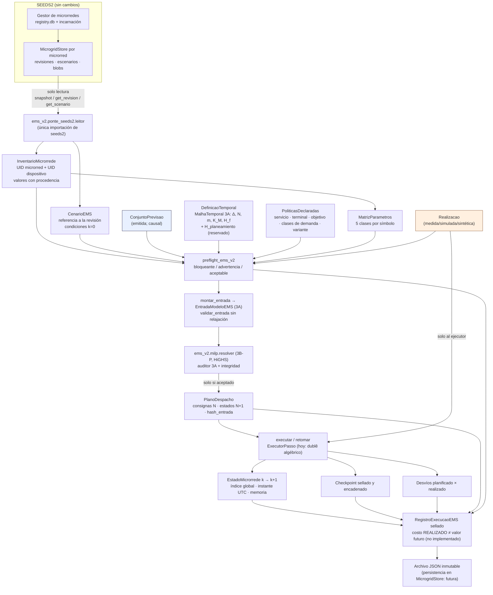

# Piso 3C-0 — Puente científico entre el EMS MILP y la plataforma de microrredes

**Estado:** contratos implementados y probados; **sin integración** con la interfaz, el Centro de Operação ni el
runtime V1.6. Base: `main` = `3c65d98` (3A + 3B-P integrados). El EMS V1.6 (`legacy_v16`) sigue siendo el único
motor operacional; ninguna funcionalidad de 3C-1 (commitment dinámico), 3C-2 (MPC), 3C-3 ni 3C-4 (valor futuro) fue
implementada.

Entregables: matriz de integración [`MATRIZ_INTEGRACAO_3C0.md`](MATRIZ_INTEGRACAO_3C0.md) · matriz de parámetros
[`MATRIZ_PARAMETROS_3C0.md`](MATRIZ_PARAMETROS_3C0.md) · brechas [`BRECHAS_3C0.md`](BRECHAS_3C0.md) · transición
[`TRANSICAO_3C0_3C1.md`](TRANSICAO_3C0_3C1.md) · evidencia [`EVIDENCIA_3C0.md`](EVIDENCIA_3C0.md).

## 1. Qué se encontró (auditoría inicial)

- `ems_v2` (3A/3B-P) ya tenía contratos por UID (`EntradaModeloEMS`), malla N/N+1, unidades exactas, procedencia,
  auditor independiente y un MILP de una ventana (`ems_v2.milp.resolver`). No tenía: lectura de microrredes, separación
  previsión × realización, plan ejecutable, estado transportable, checkpoints, registro de ejecución ni
  instrumentación. Dos tests impedían cualquier referencia `ems_v2 ↔ seeds2`.
- SEEDS2 representa cada microrred por un documento v2 (`installation.uid` de 32 hex, `equipment[]` con `eq-…`, arreglos
  FV `arr-…`, `retired[]`), revisiones inmutables en el banco de cada microrred, catálogo con incarnación (H-01/H-02) y
  escenarios versionados que referencian una revisión (`inventory_ref`) con huellas digitales.
- El único puente existente hacia un EMS (`seeds2/microgrid/adapter.py`) **agrega** equipos «equivalentes» en una
  especificación V1.6 por tecnología (p. ej. dos bloques PEMFC 3 + 1 ⇒ `N_fc = 4`): no sirve como contrato por
  dispositivo y no se reutilizó para eso (se reutilizaron sus fuentes: `PARAM_SPECS`, `derived`, `references` y las
  huellas del Piso 2A).
- El inventario no registra procedencia por parámetro, ni η de baterías, ni potencias en la barra, ni P_min/curva H₂
  de la PEMFC, ni permanencias/arranques; el V1.6 identifica parte de eso a partir de series simuladas (no aprobado).

## 2. Arquitectura (entregable D)

La realización **nunca** entra en `montar_entrada` (test `test_entrada_depende_so_da_previsao_nunca_da_realizacao`);
solo el ejecutor la recibe.

## 3. Módulos

| Módulo | Responsabilidad | Requisito |
|---|---|---|
| `ems_v2/ponte/inventario.py` | `InventarioMicrorrede`, `DispositivoInventario`, `ValorInventario`, `AssociacaoModelo`; validación (UID, mezcla de microrredes, retirados, padres FV, papel/tecnología, valores) y `recursos_ems` (expansión por unidad) | §3.1 |
| `ems_v2/ponte/requisitos.py` | `REQUISITOS` declarativos (31 símbolos) y clasificación en 5 clases por dispositivo | §3.2 |
| `ems_v2/ponte/cenario.py` | `CenarioEMS`, `CondicaoInicialDispositivo`, `DefinicaoTemporal`, `ConjuntoPrevisao`, `Realizacao`, coherencia escenario × microrred, separación previsión × realización | §3.3 |
| `ems_v2/ponte/projecao.py` | `montar_entrada` → `EntradaModeloEMS` (3A/3B-P), políticas sin valor por defecto | §3.1–3.3 |
| `ems_v2/ponte/execucao.py` | `PlanoDespacho`, `EstadoMicrorrede`, `ExecutorPasso`, `ExecutorAlgebricoReferencia`, `executar`/`retomar`, `Checkpoint`, desvíos | §3.4 |
| `ems_v2/ponte/preflight.py` | `preflight_ems_v2` → `RelatorioPreflightEMS` | §3.5 |
| `ems_v2/ponte/registro.py` | `RegistroExecucaoEMS` sellado, `CustoRealizado`, `AvaliacaoValorFuturo`, persistencia inmutable | §3.6 |
| `ems_v2/ponte/instrumentacao.py` | `Cronometro` por fase, `classificar_desfecho`, `estatisticas` (p50/p95/p99/máx) | §3.7 |
| `ems_v2/ponte/canonico.py` | JSON canónico + SHA-256 reutilizando `contracts.para_dict/de_dict` (estricto) | §3.6 |
| `ems_v2/ponte_seeds2/leitor.py` | Lector SOLO LECTURA de microrredes/escenarios reales | §3.1 |
| `ems_v2/fixtures_3c0.py` | Fixtures sintéticas de ensayo | §4 |

Núcleo (`ponte/`, `fixtures_3c0.py`): solo biblioteca estándar (test `test_nucleo_da_ponte_so_biblioteca_padrao`).

## 4. Contratos clave

- **Identidad.** Microrred = `installation.uid` + incarnación + revisión + `impressao_config` + `impressao_inventario`
  (misma regla del Piso 2A). Cada dispositivo lleva `microrrede_uid`; un instantáneo mezclado es `erro`
  (`dispositivo_de_outra_microrrede`). Un escenario de otra microrred, de otra incarnación o sobre un inventario
  físico distinto es `erro` (`cenario_de_outra_microrrede`, `incarnacao_divergente`, `inventario_divergente`).
- **Sin agregación.** Un registro = un dispositivo; los arreglos FV son dispositivos con `pai`; `quantidade` preserva
  unidades idénticas declaradas en el registro. Generadores con `quantidade > 1` ⇒ `UIDRecurso(eq, unidade=k)`;
  renovables y baterías: un recurso por registro. El estado **por unidad** no se inventa (`pendente`).
- **Presencia / habilitación / disponibilidad.** Presente (inventario activo) o retirado (solo UID); habilitado
  (inventario); disponible/indisponible (escenario; indisponible ⇒ `a = 0` en la ejecución, inventario intacto).
  Los arreglos FV heredan la disponibilidad declarada para su usina, con `aviso` explícito.
- **Tiempo.** Se reutiliza `MalhaTemporal` (3A): N intervalos, N+1 fronteras, Δ en segundos enteros. Horizonte de
  **control** (ventana del MPC de corto plazo) = `H_o = NΔ`; aplicación/reoptimización `ρ = mΔ`; misión `K_M Δ`;
  horizonte de **planeamiento** = campo reservado (`pendente` si se declara). Consignas: N valores; estados: N+1;
  consigna con N+1 valores ⇒ `instante_terminal_como_intervalo`.
- **Previsión × realización (H-01).** Clasificación POR SERIE (`cenario.classificar_separacao`): independiente;
  coincidente sin evidencia (advertencia, p. ej. series constantes o previsiones independientes idénticas); oráculo
  declarado (advertencia); procedencia compartida (advertencia de sospecha). Solo bloquea la **evidencia**: previsión
  cuya procedencia apunta al SHA-256 del contenido realizado, el mismo objeto de serie, u oráculo declarado que difiere
  de la realización. La causalidad por instante de emisión sigue bloqueante.
- **Realización offline × online (H-04).** `Realizacao.modo`: `completa_offline` (cubre la misión) o
  `incremental_online` con `observado_ate_utc = τ_k`: cobertura verificada solo en [τ_0, τ_k); valores posteriores a
  τ_k son información futura (`realizacao_alem_do_observado`). **C-02:** `executar` verifica el límite ANTES de llamar
  a cualquier `ExecutorPasso` (incluido un futuro ejecutor físico): ningún intervalo cuyo fin supere τ_k se aplica.
  Situaciones distintas: `pausada_aguardando_observacoes` (último estado válido + checkpoint; se reanuda con una
  observación posterior; **no** es inviabilidad), `interrompida_inexequivel` (consigna físicamente inexequible) y
  `erro_dados` (dato realizado ausente/desalineado/ilegible; `PassoAplicado.falha = "dados"`). **C-01:** con
  `observado_ate_utc = τ_0` (k = 0) el preflight acepta preparar la optimización con previsiones (advertencia
  `nenhum_intervalo_observado`); para k ≥ 1 exige series coherentes para los intervalos observados.
- **Plan → ejecución → estado.** El plan solo nace de un `ResultadoResolucao` aceptado y de la misma entrada
  (`hash_entrada`). El ejecutor recibe la consigna del intervalo y el entorno **realizado**; inexequible ⇒
  `interrompida_inexequivel` sin recorte. Se verifica antes y después de cada paso: microrred, índice global e
  instante de cada frontera, conjunto de UID de estado. Checkpoints sellados y encadenados; `retomar` reproduce la
  ejecución continua bit a bit o es rechazado.
- **Costo realizado ≠ valor futuro.** `CustoRealizado` se recalcula de lo aplicado + entorno realizado, solo con
  términos/coeficientes declarados; no admite término terminal. `custo_objetivo_planejado` es del plan.
  `AvaliacaoValorFuturo` = `nao_implementado_3C0`, `valor_R = None`, `contabilizado_como_custo = False` (invariante).

- **Preflight: diagnóstico × optimización (H-02).** `finalidade="diagnostico"` evalúa datos sin exigir ni crear
  políticas (`apto_para_otimizacao` siempre falso); `finalidade="otimizacao"` (por defecto) exige políticas, previsión,
  proyección existente y aceptada, formulación `v1.1-3B-P` y `ems_v2.milp.config.preflight_3bp` sin bloqueos.
- **Persistencia inmutable (H-03, C-03).** `gravar_registro` publica con `os.link(temporal_único_completo, destino)`,
  que falla si el destino existe (POSIX y NTFS). Sin hard link: **reserva** exclusiva `O_CREAT|O_EXCL`
  (`.<archivo>.reserva`) + `os.replace(temporal_completo, destino)`; un lector solo ve «ausente» o «completo», nunca un
  archivo parcial. Mismo contenido ⇒ idempotente; otro contenido ⇒ `RegistroImutavelError`; temporales y reserva
  siempre eliminados. Reserva huérfana (escritor interrumpido) ⇒ `RegistroReservaOrfaError`, nada se sobrescribe,
  recuperación manual.

## 5. Decisiones tomadas en 3C-0 (técnicas, conservadoras; a revisar por el responsable)

| ID | Decisión | Motivo |
|---|---|---|
| D-3C0-01 | Nuevo tipo de procedencia aditivo `declarado_seeds2` en `ems_v2/provenance.py` | El inventario no registra documento de origen; `nao_declarado` no sostiene valores (3A) y `fabricante` sería inventar. Aditivo: no cambia ningún hash 3A (test de hashes 3B-P intacto) |
| D-3C0-02 | Valor solo **sugerido** por el SEEDS2 (SOC 20/80 %, suciedad 0 % por defecto) ⇒ `faltante_necessario` | No inventar límites operativos |
| D-3C0-03 | Potencia de la batería derivada de C·E se registra como **terminal CC** y no satisface `Pc_max/Pd_max` (barra) | Conversión de frontera BND-BESS no aprobada (3D) |
| D-3C0-04 | Valores que el V1.6 identifica de series simuladas (η, P_min PEMFC, curva H₂, rampa PEMFC) no son fuente del EMS V2 | Método no aprobado (`EMS_TO_TALK_ABOUT.md`, B04) |
| D-3C0-05 | Disponibilidad estática del escenario ⇒ serie constante con la transformación registrada en la procedencia | Explícito y trazable; sin series de disponibilidad en SEEDS2 |
| D-3C0-06 | Arreglos FV heredan la condición de su usina (`aviso`) | El SEEDS2 declara disponibilidad por registro `eq-…` |
| D-3C0-07 | Persistencia del registro en archivo JSON inmutable; **no** en el banco de la microrred | Evitar migración del esquema SEEDS2 en esta fase |
| D-3C0-08 | Ejecutor de referencia algébrico (natureza `algebrico_referencia`) | Probar continuidad sin presentar física; adaptadores físicos en fases posteriores |
| D-3C0-09 | Percentiles por «posto mais próximo» (sin interpolación), definición registrada en cada resultado | Determinismo y reproducibilidad |

## 6. Hipótesis y límites (lo que las pruebas NO validan)

- Todas las pruebas son **contractuales/sintéticas** (marcador `synthetic_algebraic`). No hay validación física ni
  experimental. El ejecutor algébrico no es un modelo de planta.
- La cadena completa (preflight → 3A → HiGHS → plan → ejecución → registro) se ejecutó **solo** con datos
  sintéticos rotulados en contexto `ensaio`. Ninguna microrred real del SEEDS2 puede ejecutarse hoy (ver brechas).
- Los tiempos medidos en los tests no constituyen campaña ni objetivo de desempeño.

## 7. Compatibilidad

- 3A: entradas, hashes y códigos sin cambios; la proyección se valida con `validar_entrada` sin relajación.
- 3B-P: `resolver` usado tal cual; `plano_de_resultado` consume `ResultadoResolucao` sin modificarlo.
- V1.6/aplicación: `git diff 3c65d98` vacío en `ems_integration`, modelos, runtime, `seeds2`, app y requirements
  (test `test_v16_e_aplicacao_sem_alteracao_desde_a_base_auditada`); la aplicación sigue sin referenciar `ems_v2`.

## 8. Contradicciones registradas

**C-3C0-01 — lectura de microrredes × aislamiento 3B-P.** `tests/ems_v2/test_ems_v2_milp_perfil.py` prohibía que
cualquier archivo de `ems_v2` importara `seeds2`; la misión 3C-0 exige un contrato y un adaptador preliminar que lea
el inventario de una microrred seleccionada. Mover el lector a `seeds2/` violaría
`test_aplicacao_nao_referencia_ems_v2` (que sí conecta la aplicación). **Resolución conservadora:** excepción
**nominal** para un único archivo (`ems_v2/ponte_seeds2/leitor.py`), sentido de dependencia `ems_v2 → seeds2`
(lectura), y una guardia **más estricta** en `test_ems_v2_ponte_isolamento.py`: lista blanca de módulos `seeds2`
(config/derived/references/scenarios), ninguna API de escritura invocada, ningún import de UI/motor legado/solver en la
puente. El núcleo `ponte/` sigue sin `seeds2`. Si el auditor rechaza la excepción, el lector puede retirarse sin
afectar al núcleo. **Estado (auditoría PR #13): aceptada condicionalmente** — único adaptador autorizado, núcleo MILP
independiente, sin dependencia inversa desde V1.6, sin escritura, prueba de no mutación del almacenamiento (árbol de
archivos completo con SHA-256 idéntico tras varias lecturas), identidad UID/incarnación/revisión preservada, sin
excepciones genéricas en la guardia.

**C-3C0-02 — disponibilidad por usina × recurso por arreglo.** Resuelta por D-3C0-06 (herencia explícita con aviso).

## 9. Correcciones de la auditoría independiente del PR #13

| ID | Hallazgo | Corrección | Pruebas |
|---|---|---|---|
| H-01 | Igualdad numérica previsión = realización bloqueaba sin evidencia de fuga | Clasificación por serie (`CATEGORIAS_SEPARACAO`); igualdad ⇒ advertencia; bloqueo solo con evidencia (hash del contenido realizado, mismo objeto, oráculo falso); emisión sigue bloqueante | `test_h01_*` (7) en `test_ems_v2_ponte_auditoria_pr13.py`; `test_separacao_previsao_realizacao` actualizado |
| H-02 | Preflight sin políticas podía resultar «aceptado» | `finalidade` diagnóstico × optimización; `apto_para_otimizacao`; `politicas_ausentes`, `projecao_nao_aceita`, `formulacao_sem_solver`, `preflight_3bp`; UID de demanda no verificable sin políticas ⇒ advertencia (no se inventa) | `test_h02_*` (4) |
| H-03 | `exists()` + `os.replace()` permitía sobrescritura concurrente | Creación exclusiva por hard link (fallback `O_EXCL`), temporal único, limpieza garantizada, relectura acotada en el fallback | `test_h03_*` (8: procesos reales ×3, hilos, idempotencia, fallos, fallback). El mismo arnés de procesos contra el código anterior (`4b77788`) violó la inmutabilidad en 8/10 rondas |
| H-04 | Realización exigida para toda la misión (solo offline) | `Realizacao.modo` + `observado_ate_utc`; cobertura/causalidad solo hasta τ_k; ejecución que nunca sobrepasa lo observado y se reanuda | `test_h04_*` (11) |
| C-3C0-01 | Excepción de lectura SEEDS2 | Aceptada condicionalmente; prueba de no mutación ampliada al árbol completo | `test_c3c001_*`, `test_ems_v2_ponte_isolamento.py` |

Cambios contractuales que aún necesitará 3C-2 (no implementados; brecha K6 en `BRECHAS_3C0.md`): registro de
observaciones *append-only* con instante de recepción por valor (latencia, datos tardíos y revisiones de medición),
previsión reemitida por ventana (un `ConjuntoPrevisao` por τ_k), estimación del estado a partir de medidas y política
explícita para huecos de observación (nunca completados).

### 9b. Cierre de la segunda auditoría (base `d74f883`)

| ID | Punto | Corrección | Pruebas |
|---|---|---|---|
| C-01 | Preflight exigía series realizadas con k = 0 observados | `realizacao_ausente_para_recurso` solo si k ≥ 1 (offline: K_M); k = 0 ⇒ advertencia `nenhum_intervalo_observado` | `test_c01_*` (4: k=0, k=1, cobertura parcial/series ausentes, offline) |
| C-02 | El límite de observación dependía de que faltaran datos en las series | Barrera del contrato en `executar` (`limite_observado`), antes de cualquier ejecutor; pausa × inexequible × error de datos diferenciados (`PassoAplicado.falha`) | `test_c02_*` (3), con un ejecutor alternativo que NO consulta el entorno y una realización online con valores futuros |
| C-03 | Ruta sin hard link podía exponer un archivo parcial | Reserva `O_EXCL` + `os.replace` del temporal completo; reserva huérfana ⇒ error, nunca sobrescritura | `test_c03_*` (3: lector concurrente, escritores concurrentes, reserva huérfana) + `test_h03_falha_limpa_temporarios_e_nao_deixa_alvo`. Contra el código de `d74f883`, el mismo lector observó 17 097 lecturas parciales de 89 053; con la corrección, 0 de 68 418 |

Limitaciones que permanecen: Windows **no** fue ejecutado (el comportamiento de `os.link`/`os.replace` en NTFS es el
documentado por Python, no verificado aquí); la ruta alternativa supone que todos los escritores de un directorio usan
la misma ruta (el soporte de hard link es del sistema de archivos); la reserva huérfana exige recuperación manual.
